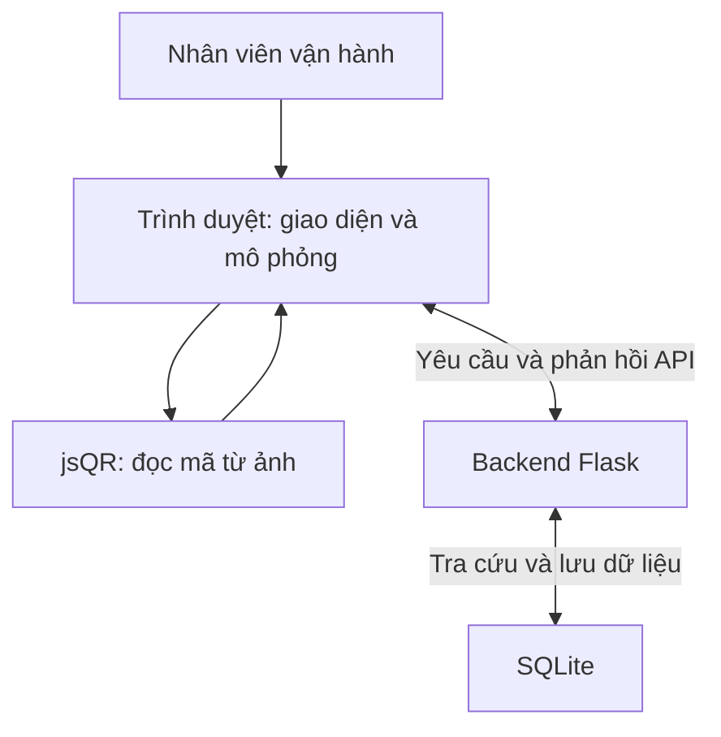
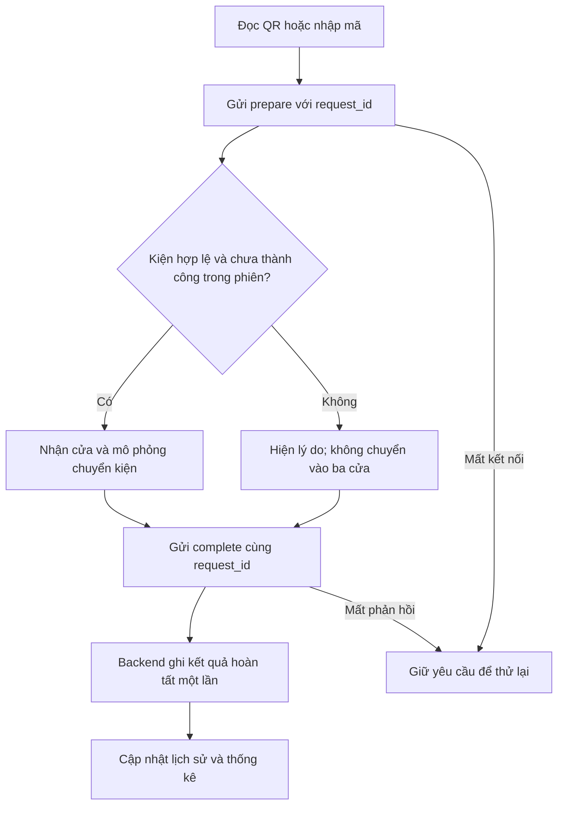

# DESIGN — Đồ án Smart Logistics nhóm 10

Trạng thái: Bản dự thảo thiết kế chung.
Căn cứ yêu cầu: project-description.md.

Tài liệu mô tả cấu trúc mà nhóm dùng để hoàn thiện và kiểm tra demo.
Trạng thái triển khai phải được đối chiếu với source và kết quả kiểm thử riêng.
Các nhánh của thành viên chưa được kiểm tra không được mặc định đã tích hợp.

## 1. Kiến trúc hệ thống

### Trách nhiệm

| Thành phần | Trách nhiệm |
|---|---|
| Trình duyệt | Nhận thao tác, chọn ảnh, đọc QR, hiển thị kết quả và chạy mô phỏng |
| Backend | Kiểm tra phiên, mã kiện, điểm đến, quy tắc, trùng và điều phối hoàn tất |
| SQLite | Lưu dữ liệu tra cứu, phiên, yêu cầu xử lý, lịch sử và số đo |
| Công cụ chuẩn bị dữ liệu | Chuyển dữ liệu tham chiếu thành dữ liệu phục vụ ứng dụng và kiểm tra tính nhất quán |
| Công cụ đánh giá | Đọc kết quả, đối chiếu đáp án và tạo báo cáo |

Backend là nơi xác định cửa.
Frontend không được tự chọn cửa rồi yêu cầu backend ghi thành công.

## 2. Các module

| Module | Đầu vào | Đầu ra hoặc trách nhiệm |
|---|---|---|
| Chuẩn bị và kiểm tra dữ liệu | Dữ liệu tham chiếu, quy tắc, ảnh QR | Dữ liệu hợp lệ và thông báo lỗi |
| Khởi tạo project | Các dữ liệu cần thiết | Database và môi trường ứng dụng ban đầu |
| Quản lý phiên | Thao tác tạo, chọn, đóng phiên | Phiên và trạng thái hiện tại |
| Đọc QR | Ảnh đầu vào | Mã đọc được hoặc kết quả không đọc được |
| Tra cứu và phân loại | Mã kiện, phiên và mã yêu cầu | Cửa dự kiến hoặc lỗi nghiệp vụ |
| Mô phỏng và hoàn tất | Kết quả phân loại | Chuyển động và yêu cầu xác nhận hoàn tất |
| Lịch sử và thống kê | Các lượt đã hoàn tất | Danh sách và số đếm đúng phiên |
| Lọc và xuất lịch sử | Phiên, điều kiện lọc hoặc yêu cầu xuất | Kết quả đầy đủ theo phạm vi đã xác định |
| Kiểm thử và đánh giá | Đáp án, lịch sử, số đo và baseline | Kết quả đối chiếu và báo cáo |

## 3. Cấu trúc source

| Vị trí | Vai trò |
|---|---|
| `app.py` | Khởi động và ghép các phần ứng dụng Flask |
| `session_routes.py` | Xử lý API liên quan đến phiên |
| `history_routes.py` | Xử lý yêu cầu phân loại, hoàn tất và truy vấn lịch sử |
| `templates/index.html` | Giao diện chính |
| `static/style.css` | Định dạng giao diện |
| `static/app.js` | Điều phối giao diện, xử lý và mô phỏng |
| `static/qr_decoder.js` | Hàm đọc QR dùng chung |
| `static/gate_stats.js` | Hiển thị thống kê cửa |
| `static/qr_evaluation.html` | Đánh giá độc lập kết quả đọc QR |
| `static/vendor/` | Thư viện phía trình duyệt |
| `data/raw/` | Dữ liệu tham chiếu ban đầu |
| `data/processed/` | Dữ liệu đã chuẩn bị cho ứng dụng |
| `data/reference/` | Bộ demo, bộ kiểm thử, ảnh và đáp án |
| `instance/` | Database chạy trên máy |
| `reports/` | Kết quả xuất và báo cáo đánh giá |
| `test_*.py` | Kiểm thử tự động |
| `xuat_va_doi_chieu.py` | Xuất lịch sử và đối chiếu đáp án |
| `nhap_so_do.py` | Kiểm tra số đo QR, năng suất và số liệu nguồn |
| `tong_hop_danh_gia.py` | Tổng hợp kết quả và tạo báo cáo |
| `docs/` | Define, Design, dữ liệu, pipeline, đánh giá và hướng dẫn |

Các công cụ khởi tạo và chuyển đổi dữ liệu nằm tại thư mục gốc theo source dự án.

Tên file mở rộng như `static/history_filters.js`, `static/history_export.js` và `khoi_tao_project.py` phải được đối chiếu với nhánh thành viên trước khi ghi nhận đã tích hợp.

## 4. Thiết kế dữ liệu

### Các nhóm dữ liệu chính

| Bảng | Vai trò |
|---|---|
| `parcels` | Mã kiện, mã đơn nguồn, điểm đến, bang và bộ dữ liệu |
| `routing_rules` | Ánh xạ điểm đến và bang tới cửa |
| `sessions` | Phiên làm việc và trạng thái mở/đóng |
| `processing_requests` | Yêu cầu đã chuẩn bị, kết quả dự kiến và trạng thái hoàn tất |
| `history` | Kết quả các lượt đã hoàn tất |
| `qr_measurements` | Số đo QR gắn với lượt lịch sử |

### Quan hệ và ràng buộc

- Mỗi mã kiện là duy nhất trong dữ liệu kiện.
- Quy tắc phân loại phải thống nhất với dữ liệu điểm đến.
- Mỗi yêu cầu xử lý có `request_id` duy nhất.
- Yêu cầu xử lý và lịch sử gắn với một phiên.
- Số đo QR gắn với lượt xử lý tương ứng qua `request_id`.
- Một kiện chỉ được ghi thành công một lần trong cùng phiên.
- Lịch sử vẫn phải biểu diễn được mã lạ hoặc mã sai; không bắt buộc mọi mã trong lịch sử đều có trong bảng kiện.
- Số đếm trên giao diện phải đối chiếu được với lịch sử đã lưu.

Chi tiết kiểu dữ liệu và ràng buộc SQL phải được cập nhật theo các script khởi tạo và nâng cấp database.

## 5. Pipeline chuẩn bị dữ liệu

1. Đọc dữ liệu tham chiếu Olist/Brazil.
2. Chọn các trường và bản ghi cần cho bài toán.
3. Làm sạch, chuẩn hoá và kiểm tra dữ liệu.
4. Tạo mã kiện và gán bộ demo hoặc kiểm thử cuối cùng.
5. Thiết lập bảng quy tắc ba cửa.
6. Tạo ảnh QR chứa mã kiện.
7. Chuẩn bị đáp án độc lập.
8. Kiểm tra mã trùng, trường trống, số lượng, phân bổ cửa và ảnh thiếu/thừa.
9. Khởi tạo dữ liệu tra cứu trong SQLite.

Điểm đến được tra từ database.
QR chỉ cần chứa mã kiện.

## 6. Pipeline xử lý một kiện

### Thứ tự kiểm tra nghiệp vụ

1. Kiểm tra phiên có tồn tại và được phép xử lý.
2. Kiểm tra yêu cầu gửi lại theo `request_id`.
3. Kiểm tra kết quả đọc QR và định dạng mã.
4. Tra cứu kiện.
5. Kiểm tra điểm đến.
6. Tra quy tắc cửa.
7. Kiểm tra kiện đã thành công trong phiên.
8. Trả kết quả chuẩn bị để frontend hiển thị.
9. Xác nhận hoàn tất và ghi lịch sử.

Nếu chưa liên lạc được với backend, frontend không được tự tạo kết quả hoàn tất.

### Gửi lại yêu cầu

- Giữ nguyên `request_id` khi thử lại cùng một thao tác.
- Nếu yêu cầu đã hoàn tất, backend trả kết quả đã lưu.
- Không chạy lại mô phỏng như một kiện mới khi nhận kết quả đã hoàn tất.
- Không tạo thêm lịch sử, số đo hoặc tăng số thành công.
- Cùng `request_id` nhưng nội dung yêu cầu khác phải bị từ chối.

## 7. Xử lý theo lô

1. Người dùng chọn phiên và tập ảnh.
2. Ứng dụng tạo hàng đợi.
3. Đọc QR của ảnh hiện tại.
4. Gửi prepare.
5. Hiển thị và mô phỏng theo kết quả.
6. Gửi complete.
7. Cập nhật kết quả ảnh và thống kê.
8. Chờ khoảng nghỉ cấu hình giữa các ảnh rồi chuyển ảnh tiếp theo.

### Quy tắc

- Không xử lý nhiều kiện đồng thời trong cùng hàng đợi.
- Không chuyển phiên giữa một lô chưa kết thúc.
- Tạm dừng phải giữ được ngữ cảnh xử lý.
- Tệp ảnh lỗi được báo riêng.
- Không đọc được QR là kết quả cần kiểm tra nghiệp vụ, khác với lỗi đọc tệp.
- Khi có yêu cầu chưa xác định đã hoàn tất hay chưa, phải giải quyết yêu cầu đó trước khi tạo thao tác mới.

## 8. Giao tiếp frontend–backend

| API | Vai trò |
|---|---|
| `GET /api/health` | Kiểm tra backend và trạng thái dịch vụ theo chức năng hiện có |
| `POST /api/history/prepare` | Kiểm tra và chuẩn bị kết quả xử lý |
| `POST /api/history/<request_id>/complete` | Xác nhận hoàn tất theo yêu cầu đã chuẩn bị |
| `GET /api/history` | Lấy lịch sử theo phiên, có phân trang |
| `GET /api/history/<request_id>/measurement` | Lấy số đo đã lưu của lượt xử lý |

Các API tạo, lấy và đóng phiên được quản lý tại `session_routes.py`.
Tên đường dẫn, tham số phân trang và cấu trúc phản hồi phải được đối chiếu với source khi chốt hợp đồng API chi tiết.

### Yêu cầu prepare

Các thông tin chính:

- `request_id`: mã yêu cầu.
- `session_id`: phiên đang xử lý.
- `code`: mã kiện đọc được hoặc nhập tay.
- `source`: nguồn nhập.

Phản hồi cần cho biết kết quả chuẩn bị hoặc kết quả đã hoàn tất nếu là yêu cầu gửi lại.

### Yêu cầu complete

- Dùng cùng `request_id` của bước prepare.
- Có thể gửi số đo QR khi đúng nguồn và đúng định dạng.
- Backend dùng kết quả đã chuẩn bị, không nhận cửa do frontend tự quyết định.
- Ghi lịch sử, số đo và trạng thái hoàn tất trong giao dịch nhất quán.
- Nếu dữ liệu gửi lên không hợp lệ, không để lại trạng thái ghi dở dang.

## 9. Lịch sử, bộ lọc và xuất CSV

### Lịch sử

- Hiển thị đúng phiên đang chọn.
- Có phân trang.
- Hiển thị trạng thái, lý do, nguồn nhập và thời gian.
- Tổng thống kê phải bao phủ toàn bộ phiên, không chỉ trang đang xem.

### Bộ lọc

- Tìm mã kiện.
- Lọc thành công/thất bại và nguồn nhập.
- Kết hợp điều kiện và có thao tác xoá bộ lọc.
- Áp dụng trên toàn bộ lịch sử phiên, gồm các trang chưa hiển thị.
- Chuyển phiên không giữ nhầm kết quả từ phiên trước.

### Xuất CSV trên web

- Xuất đầy đủ lịch sử của phiên được chọn.
- Không lẫn dữ liệu phiên khác.
- Có tiêu đề cột và mở được bằng Excel với tiếng Việt.
- Xử lý dấu phẩy, dấu ngoặc kép, xuống dòng và nội dung có thể bị Excel diễn giải thành công thức.
- Không tải file thiếu hoặc báo thành công nếu lấy dữ liệu thất bại giữa chừng.
- Giữ công cụ xuất và đối chiếu đánh giá bằng Python.

Phạm vi xuất theo phiên và phạm vi lọc phải được ghi rõ trên giao diện.
Không tự đổi ý nghĩa “xuất toàn bộ phiên” thành “xuất trang đang hiển thị”.

## 10. Thiết kế đo và đánh giá

### Độ chính xác QR

- Đọc ảnh thật bằng hàm QR dùng chung với ứng dụng.
- So sánh nội dung đọc được với CSV đáp án độc lập.
- Lưu cả ảnh đọc sai hoặc không đọc được.
- Kiểm tra tên ảnh và dấu vết SHA256 để đối chiếu đúng đầu vào.
- Tách kết quả ảnh có QR với kết quả từ chối ảnh không QR.

### Thời gian xác định cửa

Đo từ lúc xử lý ảnh QR đến khi nhận kết quả cửa từ backend theo phạm vi phép đo đã triển khai.
Báo rõ điểm bắt đầu/kết thúc và các bước nằm ngoài phép đo.

Không cộng thời gian hoạt ảnh vào phép so sánh xác định cửa với baseline.

### Năng suất mô phỏng

Đo thời lượng lô từ trước xử lý ảnh đầu đến phản hồi hoàn tất cuối hoặc kết thúc lỗi tệp cuối.

- Tử số: số kiện thành công được xác nhận hoàn tất.
- Mẫu số: thời lượng lô tính bằng phút.
- Tính hoạt ảnh, khoảng nghỉ giữa ảnh và xử lý xen giữa.
- Không tính khoảng nghỉ sau ảnh cuối.
- Ghi số ảnh, số thành công, lỗi nghiệp vụ, lỗi tệp và cấu hình chạy.
- Lần bị đổi tab, tạm dừng hoặc gián đoạn phải được nhận diện và loại khỏi kết luận năng suất chính thức.

### Tổng hợp báo cáo

1. Xuất lịch sử và số đo của phiên.
2. Đối chiếu với đáp án định tuyến.
3. Nhập kết quả đánh giá QR và năng suất nếu có.
4. Kiểm tra lại số liệu và tệp nguồn.
5. Xuất bảng tổng hợp và báo cáo HTML.

Phân biệt rõ:

- Báo cáo xem thử: cho phép bộ chưa hoàn chỉnh và hiện mục chưa có số liệu.
- Báo cáo đủ bộ: phải đáp ứng điều kiện dữ liệu, phiên, số đo và baseline đã chốt.
- Có báo cáo đủ bộ không đồng nghĩa đạt toàn bộ đồ án; còn phải xét kiểm thử lỗi và các yêu cầu khác.

## 11. Trình tự hoàn thiện

| Mốc | Công việc | Đầu ra để chuyển bước |
|---|---|---|
| M1 | Rà và thống nhất Define, Design | Phạm vi, module, pipeline và tiêu chí rõ ràng |
| M2 | Đối chiếu source và phần thành viên | Bảng đã có/cần sửa/chưa có, người phụ trách và minh chứng |
| M3 | Tích hợp từng phần đã kiểm tra | Luồng chính và chức năng liên quan chạy đúng |
| M4 | Kiểm thử lỗi và chốt phiên bản đánh giá | Bộ tình huống, đáp án và kết quả kiểm tra |
| M5 | Đánh giá và so sánh baseline | Số liệu, điều kiện chạy và phân tích |
| M6 | Hoàn thiện bàn giao | Hướng dẫn chạy, báo cáo, slide và demo |

Không tích hợp đồng thời nhiều nhánh chưa kiểm tra.
Sau mỗi lần tích hợp, chạy lại các kiểm tra có liên quan.

## 12. Phân công theo vai trò

| Phần | Trách nhiệm |
|---|---|
| Trưởng nhóm | Chốt yêu cầu/API, xử lý lõi, số đo, tích hợp và báo cáo |
| Thành viên phần 1 | Kiểm tra dữ liệu |
| Thành viên phần 2 | Khởi tạo project bằng một lệnh |
| Thành viên phần 3 | Bổ sung kiểm thử backend |
| Thành viên phần 4 | Bộ lọc lịch sử |
| Thành viên phần 5 | Xuất lịch sử CSV trên web |

Tên người, nhánh, PR và trạng thái nghiệm thu được cập nhật sau khi xác nhận.
Không suy ra hoàn thành từ số commit hoặc số PR.

## 13. Rủi ro và cách xử lý

| Rủi ro | Cách xử lý |
|---|---|
| Tăng phạm vi | Bám yêu cầu bắt buộc, giữ mở rộng tách biệt |
| Dữ liệu không khớp quy tắc | Kiểm tra dữ liệu trước khởi tạo và đánh giá |
| QR không đọc được | Có kịch bản lỗi; nhập tay ghi đúng nguồn |
| Mất phản hồi hoặc gửi lại | Giữ request_id, kiểm tra kết quả cũ, không ghi trùng |
| Đổi phiên khi đang xử lý | Khoá hoặc từ chối thao tác theo trạng thái |
| Số đo bị gián đoạn | Lưu lý do loại và không dùng kết luận năng suất chính thức |
| Bộ lọc/xuất CSV chỉ lấy trang đầu | Kiểm tra bằng phiên có nhiều trang |
| Các nhánh sửa file chung | PR nhỏ, kiểm tra và tích hợp lần lượt |
| Demo chỉ có dữ liệu đẹp | Bổ sung mã lạ, thiếu dữ liệu, trùng và lỗi kết nối |
| Kết luận vượt dữ liệu thử | Nêu rõ quy mô, điều kiện và giới hạn mô phỏng |

## 14. Điều kiện chốt Design

- Mỗi yêu cầu trong Define có module chịu trách nhiệm.
- Có luồng bình thường và luồng lỗi.
- Có cách chống trùng và phục hồi khi mất phản hồi.
- Có thiết kế dữ liệu và giao tiếp giữa các thành phần.
- Có kịch bản kiểm chứng cho chức năng bắt buộc.
- Có thứ tự tích hợp và trách nhiệm từng phần.
- Phần chưa đối chiếu source được đánh dấu, không ghi là đã triển khai.