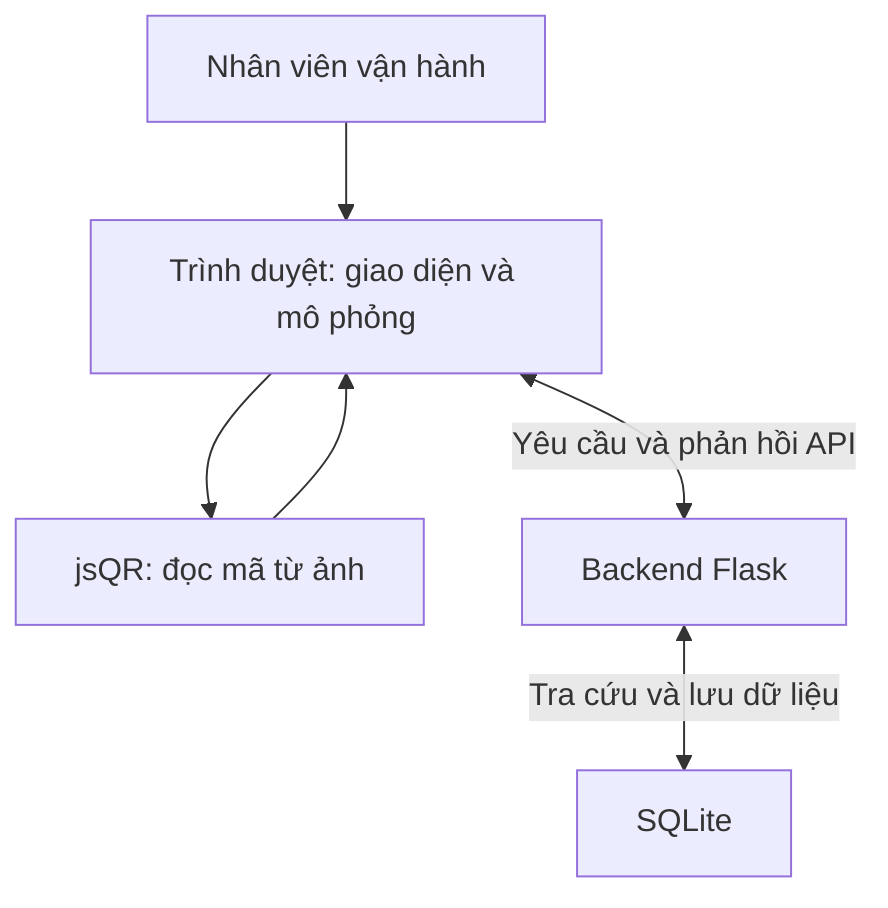
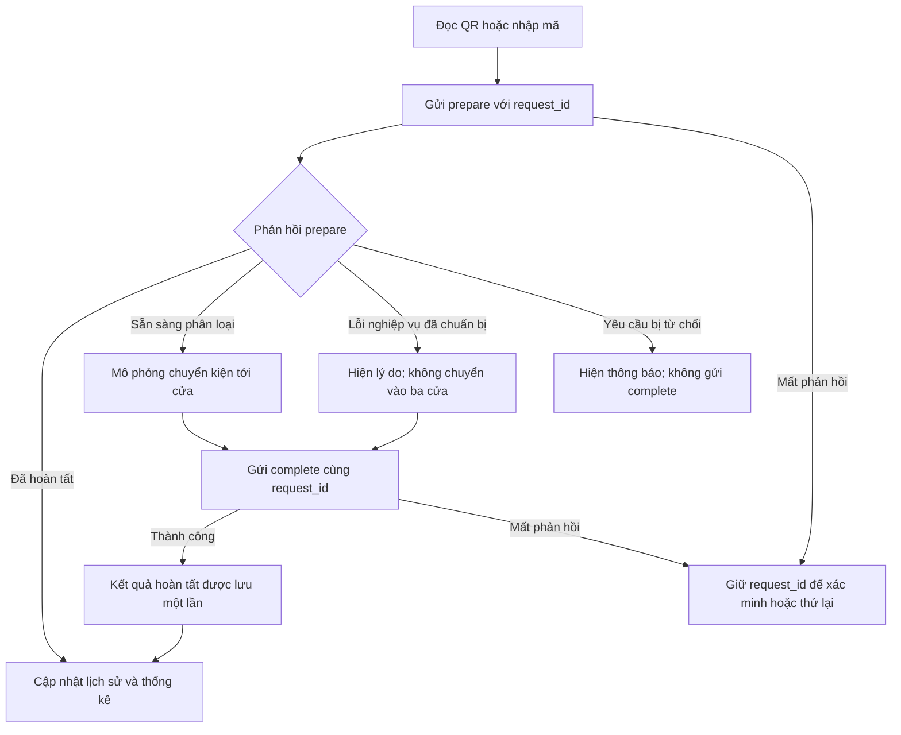

# DESIGN — Đồ án Smart Logistics nhóm 10

Trạng thái: Bản dự thảo thiết kế chung.
Căn cứ yêu cầu: project-description.md.

Tài liệu mô tả cấu trúc mà nhóm dùng để hoàn thiện và kiểm tra demo.
Trạng thái triển khai được theo dõi tại implementation-status.md,
dựa trên source và kết quả kiểm thử.

Các nhánh của thành viên chưa được kiểm tra không được mặc định đã tích hợp.

## 1. Kiến trúc hệ thống



### Trách nhiệm

| Thành phần | Trách nhiệm |
|---|---|
| Trình duyệt | Nhận thao tác, chọn ảnh, đọc QR, hiển thị kết quả và chạy mô phỏng |
| Backend | Kiểm tra phiên, mã kiện, điểm đến, quy tắc, trùng và điều phối hoàn tất |
| SQLite | Lưu dữ liệu tra cứu, phiên, yêu cầu xử lý, lịch sử và số đo |
| Công cụ chuẩn bị dữ liệu | Chuyển dữ liệu tham chiếu thành dữ liệu phục vụ ứng dụng và kiểm tra tính nhất quán |
| Công cụ đánh giá | Đọc kết quả, đối chiếu đáp án và tạo báo cáo |

Backend là nơi xác định cửa.
Frontend không được tự chọn cửa rồi yêu cầu backend ghi thành công.

## 2. Các module

| Module | Đầu vào | Đầu ra hoặc trách nhiệm |
|---|---|---|
| Chuẩn bị và kiểm tra dữ liệu | Dữ liệu tham chiếu, quy tắc, ảnh QR | Dữ liệu hợp lệ và thông báo lỗi |
| Khởi tạo project | Các dữ liệu cần thiết | Database và môi trường ứng dụng ban đầu |
| Quản lý phiên | Thao tác tạo, chọn, đóng phiên | Phiên và trạng thái hiện tại |
| Đọc QR | Ảnh đầu vào | Mã đọc được hoặc kết quả không đọc được |
| Tra cứu và phân loại | Mã kiện, phiên và mã yêu cầu | Cửa dự kiến hoặc lỗi nghiệp vụ |
| Mô phỏng và hoàn tất | Kết quả phân loại | Chuyển động và yêu cầu xác nhận hoàn tất |
| Lịch sử và thống kê | Các lượt đã hoàn tất | Danh sách và số đếm đúng phiên |
| Lọc và xuất lịch sử | Phiên, điều kiện lọc hoặc yêu cầu xuất | Kết quả đầy đủ theo phạm vi đã xác định |
| Kiểm thử và đánh giá | Đáp án, lịch sử, số đo và baseline | Kết quả đối chiếu và báo cáo |

Bộ lọc lịch sử và xuất CSV trên web là phần mở rộng.
Trạng thái của chúng được kiểm tra riêng với chức năng bắt buộc.

### Đối chiếu yêu cầu với module

Mã F01–F11 giữ đúng ý nghĩa trong project-description.md.

| Mã | Yêu cầu trong Define | Module hoặc file liên quan | Cách kiểm chứng chính |
|---|---|---|---|
| F01 | Một trạm, một băng chuyền và ba cửa | templates/index.html, static/style.css, static/app.js | Quan sát bố cục và nhãn ba cửa |
| F02 | Đọc QR từ ảnh | static/qr_decoder.js, static/app.js, static/vendor/ | Đối chiếu mã đọc từ ảnh với đáp án |
| F03 | Nhập mã bằng tay | templates/index.html, static/app.js, history_routes.py | Nhập mã và kiểm tra kết quả, nguồn manual |
| F04 | Tra cứu và xác định cửa | history_routes.py, parcels, routing_rules | Đối chiếu cửa và lỗi nghiệp vụ với đáp án |
| F05 | Mô phỏng tuần tự | static/app.js, history_routes.py | Kiểm tra thứ tự, đúng lượt và xác nhận hoàn tất |
| F06 | Quản lý phiên | session_routes.py, history_routes.py, static/app.js | Tạo, chọn, đóng và khôi phục lượt đang chờ |
| F07 | Chống phân loại trùng | history_routes.py, ràng buộc database | Quét lại không tăng số thành công trong cùng phiên |
| F08 | Xử lý lỗi | history_routes.py, static/qr_decoder.js, static/app.js | Thực hiện các tình huống lỗi đã chốt |
| F09 | Lưu lịch sử | history_routes.py, processing_requests, history | Gửi lại không nhân đôi; ghi lỗi phải hoàn tác |
| F10 | Thống kê | session_routes.py, static/app.js, static/gate_stats.js | Đối chiếu tổng phiên và từng cửa với toàn bộ lịch sử |
| F11 | Đánh giá | static/qr_evaluation.html, các công cụ đo và báo cáo Python | Có đáp án, số đo, điều kiện thử và kết quả baseline |

Có file liên quan chưa đồng nghĩa yêu cầu đã hoàn thành.
Kết quả nghiệm thu được ghi riêng trong implementation-status.md.

## 3. Cấu trúc source

### Cây thư mục và vai trò

Cấu trúc dưới đây giữ cách tổ chức source đang sử dụng.
Các file Python hiện nằm ở thư mục gốc; không yêu cầu chuyển sang src/.

```text
SmartLogisticsQR_Project/
├── docs/                            # Yêu cầu, thiết kế và tiến độ
│   ├── project-description.md       # Define: phạm vi và tiêu chí hoàn thành
│   ├── system-design.md             # Design: kiến trúc, cấu trúc và pipeline
│   └── implementation-status.md     # Trạng thái và bằng chứng kiểm tra
│
├── data/                            # Dữ liệu đầu vào và dữ liệu phục vụ bài toán
│
├── instance/                        # Dữ liệu lưu khi chạy trên máy
│   └── smartlogistics.db            # SQLite: kiện, quy tắc, phiên và lịch sử
│
├── reports/                         # Báo cáo và bằng chứng của từng lần xuất
│
├── static/                          # Tài nguyên chạy phía trình duyệt
│   ├── app.js                       # Điều phối giao diện, phiên, QR và mô phỏng
│   ├── qr_decoder.js                # Hàm đọc QR dùng chung
│   ├── gate_stats.js                # Hiển thị số kiện từng cửa
│   ├── qr_evaluation.html           # Trang đánh giá đọc QR độc lập
│   ├── style.css                    # Định dạng giao diện
│   └── vendor/                      # Thư viện trình duyệt, gồm jsQR
│
├── templates/
│   └── index.html                   # Giao diện chính do Flask phục vụ
│
├── app.py                           # Điểm khởi động ứng dụng Flask
├── session_routes.py                # API tạo, liệt kê và đóng phiên
├── history_routes.py                # Prepare, complete, lịch sử và số đo
│
├── chuan_bi_du_lieu_ung_dung.py      # Chuẩn bị dữ liệu cho ứng dụng
├── lam_sach_du_lieu.py               # Làm sạch dữ liệu
├── kiem_tra_du_lieu.py               # Kiểm tra dữ liệu; đối chiếu bản bàn giao
├── init_db.py                       # Khởi tạo dữ liệu tra cứu theo script
├── init_tracking.py                 # Khởi tạo phần theo dõi phiên và lịch sử
├── nang_cap_xu_ly.py                 # Nâng cấp cấu trúc lưu xử lý
│
├── do_phan_loai_thu_cong.py          # Bài đo baseline thủ công
├── doi_chieu_du_lieu.py              # Công cụ đối chiếu dữ liệu
├── xuat_va_doi_chieu.py              # Xuất lịch sử và đối chiếu đáp án
├── nhap_so_do.py                     # Kiểm tra số đo và tệp nguồn
├── tong_hop_danh_gia.py              # Tổng hợp số liệu và báo cáo HTML
│
├── test_completion_flow.py          # Kiểm thử hoàn tất, số đo và hoàn tác
├── test_concurrent_requests.py      # Kiểm thử yêu cầu đồng thời và gửi lại
├── test_destination_errors.py       # Kiểm thử lỗi dữ liệu điểm đến
│
├── requirements.txt                 # Thư viện Python của dự án
├── README.md                        # Giới thiệu và hướng dẫn chạy
└── .gitignore                       # Quy định loại trừ file khỏi Git
```

Cây thư mục mô tả các thành phần chính, không liệt kê mọi tệp sinh ra,
database sao lưu hoặc tài nguyên dữ liệu bên trong.

Tên script thể hiện vai trò tổ chức.
Chi tiết đầu vào, đầu ra và thứ tự chạy của các script dữ liệu,
khởi tạo phải được đối chiếu với source và bản bàn giao.

### Tổ chức dữ liệu

| Vị trí trong thiết kế | Vai trò |
|---|---|
| data/raw/ | Dữ liệu tham chiếu ban đầu |
| data/processed/ | Dữ liệu đã chuẩn bị cho ứng dụng |
| data/reference/ | Bộ demo, bộ kiểm thử, ảnh và đáp án |
| instance/ | Database dùng khi chạy |
| reports/ | Kết quả xuất và báo cáo đánh giá |

Các đường dẫn con của data/ là cách tổ chức nêu trong thiết kế.
Trước khi ghi lệnh chạy hoặc đổi đường dẫn, cần đối chiếu cây thư mục
và đường dẫn thực tế trong script.

Không tự tạo lại dữ liệu hoặc di chuyển tệp chỉ để khớp hình thức tài liệu.
Nếu source đang dùng đường dẫn khác, cập nhật tài liệu hoặc lập thay đổi
có kiểm tra đầy đủ các nơi đọc đường dẫn đó.

### Phần dự kiến từ thành viên

| Thành phần dự kiến | Vai trò | Điều kiện ghi vào cấu trúc đã tích hợp |
|---|---|---|
| Công cụ khởi tạo bằng một lệnh | Chạy các bước khởi tạo đúng thứ tự | Rà source và thử trên môi trường mới |
| static/history_filters.js hoặc file tương đương | Lọc lịch sử theo phạm vi đã chốt | Kiểm tra trên toàn bộ lịch sử phiên |
| static/history_export.js hoặc file tương đương | Xuất CSV trên web | Kiểm tra đủ dữ liệu và xử lý lỗi xuất |
| Phần kiểm tra dữ liệu bổ sung | Kiểm tra bộ dữ liệu và fixture lỗi | Rà bản bàn giao với script hiện có |
| Các bài kiểm thử bổ sung | Bổ sung phạm vi còn thiếu | Rà nội dung, tránh trùng và chạy bộ thử liên quan |

Tên file như khoi_tao_project.py, history_filters.js
và history_export.js phải được xác nhận theo nhánh thành viên.

Không ghi các file dự kiến thành file đã tích hợp.
Nếu thành viên sửa file đang có, rà thay đổi và tích hợp vào file đó;
không bắt buộc tạo file mới cho mỗi nhiệm vụ.

## 4. Thiết kế dữ liệu

### Các nhóm dữ liệu chính

| Bảng | Vai trò |
|---|---|
| parcels | Mã kiện, mã đơn nguồn, điểm đến, bang và bộ dữ liệu |
| routing_rules | Ánh xạ điểm đến và bang tới cửa |
| sessions | Phiên làm việc và trạng thái mở/đóng |
| processing_requests | Yêu cầu đã chuẩn bị, kết quả dự kiến và trạng thái hoàn tất |
| history | Kết quả các lượt đã hoàn tất |
| qr_measurements | Số đo QR gắn với lượt lịch sử |

### Quan hệ và ràng buộc

- Mỗi mã kiện là duy nhất trong dữ liệu kiện.
- Quy tắc phân loại phải thống nhất với dữ liệu điểm đến.
- Mỗi yêu cầu xử lý có request_id duy nhất.
- Yêu cầu xử lý và lịch sử gắn với một phiên.
- Số đo QR gắn với lượt xử lý tương ứng qua request_id.
- Một kiện chỉ được ghi thành công một lần trong cùng phiên.
- Mỗi phiên chỉ cho phép một yêu cầu chưa hoàn tất tại một thời điểm.
- Lịch sử vẫn phải biểu diễn được mã lạ hoặc mã sai; không bắt buộc mọi mã trong lịch sử đều có trong bảng kiện.
- Số đếm trên giao diện phải đối chiếu được với lịch sử đã lưu.

Chi tiết kiểu dữ liệu, khóa và ràng buộc SQL phải được đối chiếu
với các script khởi tạo và nâng cấp database.

## 5. Pipeline chuẩn bị dữ liệu

1. Đọc dữ liệu tham chiếu Olist/Brazil.
2. Chọn các trường và bản ghi cần cho bài toán.
3. Làm sạch, chuẩn hoá và kiểm tra dữ liệu.
4. Tạo mã kiện và gán bộ demo hoặc kiểm thử cuối cùng.
5. Thiết lập bảng quy tắc ba cửa.
6. Tạo ảnh QR chứa mã kiện.
7. Chuẩn bị đáp án độc lập.
8. Kiểm tra mã trùng, trường trống, số lượng, phân bổ cửa và ảnh thiếu/thừa.
9. Khởi tạo dữ liệu tra cứu trong SQLite.

Điểm đến được tra từ database.
QR chỉ cần chứa mã kiện.

Bộ demo và bộ kiểm thử cuối cùng phải tách biệt theo Define.
Đáp án được chốt trước khi đánh giá, không sửa theo kết quả ứng dụng.

## 6. Pipeline xử lý một kiện



### Thứ tự kiểm tra nghiệp vụ

1. Kiểm tra cấu trúc đầu vào, UUID, kiểu và độ dài mã kiện, nguồn nhập.
2. Tìm yêu cầu cũ theo request_id và đối chiếu nội dung. Nếu đã hoàn tất thì trả kết quả cũ; nếu đang chờ thì trả trạng thái chờ; khác nội dung thì từ chối.
3. Với yêu cầu mới, kiểm tra phiên tồn tại và đang mở.
4. Kiểm tra phiên không còn yêu cầu khác chưa hoàn tất.
5. Kiểm tra kết quả đọc QR, định dạng mã và tra cứu kiện.
6. Kiểm tra thông tin điểm đến và quy tắc cửa.
7. Kiểm tra kiện đã thành công trong cùng phiên.
8. Lưu kết quả chuẩn bị và trả về cho frontend.
9. Khi nhận complete, ghi lịch sử, số đo nếu có và trạng thái hoàn tất trong cùng giao dịch. Gửi lại yêu cầu đã hoàn tất chỉ trả kết quả cũ.

Nếu chưa liên lạc được với backend,
frontend không được tự tạo kết quả hoàn tất.

### Phân biệt lỗi nghiệp vụ và yêu cầu bị từ chối

Lỗi nghiệp vụ là kết quả của yêu cầu đã được chuẩn bị,
chẳng hạn không đọc được QR, mã sai định dạng, không tìm thấy kiện,
thiếu điểm đến, chưa cấu hình cửa hoặc kiện bị trùng.

Frontend dùng request_id của yêu cầu đó để xác nhận hoàn tất
và ghi lịch sử lỗi.

Nếu API từ chối yêu cầu vì đầu vào không hợp lệ, phiên không tồn tại,
phiên đã đóng, phiên đang bận hoặc request_id xung đột,
frontend hiển thị thông báo và không tự gửi complete
cho thao tác bị từ chối.

Nếu mất kết nối hoặc mất phản hồi, frontend giữ nguyên request_id
để xác minh hoặc thử lại, không tự coi lượt xử lý đã hoàn tất.

### Gửi lại yêu cầu

- Giữ nguyên request_id khi thử lại cùng một thao tác.
- Gửi lại prepare phải giữ nguyên phiên, mã kiện và nguồn nhập.
- Nếu yêu cầu đã hoàn tất, backend trả kết quả đã lưu, kể cả khi phiên sau đó đã đóng.
- Không chạy lại mô phỏng như một kiện mới khi nhận kết quả đã hoàn tất.
- Không tạo thêm lịch sử, số đo hoặc tăng số thành công.
- Cùng request_id nhưng nội dung prepare khác phải bị từ chối.
- Gửi lại complete của lượt đã hoàn tất không ghi đè số đo cũ.

### Quản lý trạng thái phiên

- Phiên mới có trạng thái active.
- Phiên đã đóng có trạng thái closed.
- Không tạo lượt xử lý mới trong phiên đã đóng.
- Không đóng phiên khi còn yêu cầu chưa hoàn tất.
- Gửi lại thao tác đóng một phiên đã đóng trả trạng thái phiên hiện có.
- Có thể truy vấn yêu cầu đang chờ để phục hồi ngữ cảnh xử lý.

## 7. Xử lý theo lô

1. Người dùng chọn phiên và tập ảnh.
2. Ứng dụng tạo hàng đợi.
3. Đọc QR của ảnh hiện tại.
4. Gửi prepare.
5. Hiển thị và mô phỏng theo kết quả.
6. Gửi complete nếu yêu cầu đang chờ hoàn tất.
7. Cập nhật kết quả ảnh và thống kê.
8. Chờ khoảng nghỉ cấu hình giữa các ảnh rồi chuyển ảnh tiếp theo.

Nếu nhận kết quả đã hoàn tất ở bước prepare,
không chạy lại mô phỏng và không tạo thêm lượt.

### Quy tắc

- Không xử lý nhiều kiện đồng thời trong cùng hàng đợi.
- Không chuyển phiên giữa một lô chưa kết thúc.
- Tạm dừng phải giữ được ngữ cảnh xử lý.
- Tệp ảnh lỗi được báo riêng.
- Không đọc được QR là kết quả cần kiểm tra nghiệp vụ, khác với lỗi đọc tệp.
- Khi có yêu cầu chưa xác định đã hoàn tất hay chưa, phải giải quyết yêu cầu đó trước khi tạo thao tác mới.
- Yêu cầu bị API từ chối không được coi là kiện đã hoàn tất.
- Không chờ khoảng nghỉ sau ảnh cuối.

## 8. Giao tiếp frontend–backend

### Các API

| API | Vai trò |
|---|---|
| GET /api/health | Kiểm tra backend theo chức năng hiện có; chi tiết cần đối chiếu app.py |
| POST /api/sessions | Tạo phiên mới |
| GET /api/sessions | Lấy tối đa 50 phiên gần nhất, kèm số lượt đang chờ và thống kê lịch sử |
| POST /api/sessions/<session_id>/close | Đóng phiên nếu không còn yêu cầu chưa hoàn tất |
| GET /api/sessions/<session_id>/pending | Lấy thông tin yêu cầu chưa hoàn tất để phục hồi |
| POST /api/history/prepare | Kiểm tra và chuẩn bị kết quả xử lý |
| POST /api/history/<request_id>/complete | Xác nhận hoàn tất theo yêu cầu đã chuẩn bị |
| GET /api/history | Lấy lịch sử, có thể giới hạn theo phiên và phân trang |
| GET /api/history/<request_id>/measurement | Lấy số đo đã lưu của lượt hoàn tất |

POST /api/history là đường dẫn cũ.
Backend từ chối xử lý trực tiếp và yêu cầu dùng prepare rồi complete.

### Tạo phiên

Gửi đối tượng JSON có trường name.

- Tên phiên sau khi bỏ khoảng trắng hai đầu dài từ 1 đến 100 ký tự.
- Nếu không có trường name, dùng tên mặc định.
- Backend tạo UUID và thời điểm tạo.
- Phiên mới có trạng thái active.

### Yêu cầu prepare

Các thông tin chính:

- request_id: UUID của yêu cầu.
- session_id: UUID của phiên.
- code: chuỗi mã kiện, tối đa 64 ký tự.
- source: nguồn nhập, nhận manual, qr, auto hoặc api.

Luồng giao diện nhập tay dùng manual.
Luồng đọc QR từ ảnh dùng qr, gồm cả chế độ chọn một ảnh và chạy lô.

Mã kiện hợp lệ theo nghiệp vụ có dạng KH và ba chữ số.
Chuỗi rỗng từ nguồn qr được xử lý thành lỗi không đọc được QR.

Phản hồi thành công có:

- phase: pending hoặc completed.
- result: thông tin kết quả tương ứng.

Với lượt hợp lệ đang chờ mô phỏng,
trạng thái trả về là ready và chưa tính thành công.

Yêu cầu mới được chuẩn bị trả HTTP 201.
Yêu cầu cũ có nội dung khớp trả HTTP 200.

### Yêu cầu complete

- Dùng cùng request_id của bước prepare.
- Có thể không gửi body để tương thích với luồng chưa có số đo.
- Nếu gửi body, chỉ nhận đối tượng JSON với trường tùy chọn measurement.
- Chỉ lượt có nguồn qr mới được gửi số đo QR.
- Backend dùng kết quả đã chuẩn bị, không nhận cửa do frontend tự quyết định.
- Kiểm tra lại chống trùng trước khi ghi thành công.
- Ghi lịch sử, số đo và trạng thái hoàn tất trong cùng giao dịch.
- Nếu số đo không hợp lệ, không ghi lịch sử hoặc hoàn tất dở dang.
- Lượt hoàn tất mới trả HTTP 201.
- Lượt đã hoàn tất trả kết quả cũ với HTTP 200.

### Số đo QR

Số đo gồm phiên bản, chế độ đọc, tên ảnh, SHA256 nếu có,
thời gian đọc ảnh, thời gian prepare, thời gian xác định cửa,
thời gian hoạt ảnh và trạng thái hợp lệ.

Các điều kiện chính:

- Phiên bản số đo là số nguyên 1.
- Chế độ là single hoặc batch.
- Các thời gian được cung cấp phải hữu hạn và không âm.
- Số đo hợp lệ phải có đủ các trường thời gian.
- Số đo bị gián đoạn phải ghi lý do.
- Số đo hợp lệ không có lý do gián đoạn.
- SHA256 nếu được cung cấp phải đúng định dạng.

Kiểm tra định dạng số đo không thay thế việc đối chiếu tệp nguồn
và điều kiện chạy trong công cụ đánh giá.

### Phân trang lịch sử

Các tham số:

- session_id: UUID phiên; giao diện lịch sử theo phiên phải gửi tham số này.
- limit: số nguyên từ 1 đến 100, mặc định 100.
- before_id: ID nguyên dương; lấy các bản ghi có ID nhỏ hơn giá trị này.

Phản hồi gồm:

- history: các bản ghi của trang.
- limit: giới hạn đã dùng.
- has_more: còn trang tiếp theo hay không.
- next_before_id: mốc để lấy trang tiếp theo, hoặc null.

Lịch sử được sắp theo ID giảm dần.
Các lần lấy trang tiếp theo phải giữ nguyên phiên.

## 9. Lịch sử, bộ lọc và xuất CSV

### Lịch sử

- Hiển thị đúng phiên đang chọn.
- Có phân trang.
- Hiển thị trạng thái, lý do, nguồn nhập và thời gian.
- Tổng thống kê phải bao phủ toàn bộ phiên, không chỉ trang đang xem.

### Bộ lọc

- Tìm mã kiện.
- Lọc thành công/thất bại và nguồn nhập.
- Kết hợp điều kiện và có thao tác xoá bộ lọc.
- Áp dụng trên toàn bộ lịch sử phiên, gồm các trang chưa hiển thị.
- Chuyển phiên không giữ nhầm kết quả từ phiên trước.

Cách triển khai bộ lọc phải được đối chiếu với nhánh thành viên.
Không mặc định API lịch sử hiện tại đã hỗ trợ mọi điều kiện lọc.

### Xuất CSV trên web

- Xuất đầy đủ lịch sử của phiên được chọn.
- Không lẫn dữ liệu phiên khác.
- Có tiêu đề cột và mở được bằng Excel với tiếng Việt.
- Xử lý dấu phẩy, dấu ngoặc kép, xuống dòng và nội dung có thể bị Excel diễn giải thành công thức.
- Không tải file thiếu hoặc báo thành công nếu lấy dữ liệu thất bại giữa chừng.
- Giữ công cụ xuất và đối chiếu đánh giá bằng Python.

Phạm vi xuất theo phiên và phạm vi lọc phải được ghi rõ trên giao diện.
Không tự đổi ý nghĩa “xuất toàn bộ phiên” thành “xuất trang đang hiển thị”.

## 10. Thiết kế đo và đánh giá

### Độ chính xác QR

- Đọc ảnh thật bằng hàm QR dùng chung với ứng dụng.
- So sánh nội dung đọc được với CSV đáp án độc lập.
- Lưu cả ảnh đọc sai hoặc không đọc được.
- Kiểm tra tên ảnh và dấu vết SHA256 để đối chiếu đúng đầu vào.
- Tách kết quả ảnh có QR với kết quả từ chối ảnh không QR.
- Báo riêng ảnh thiếu và lỗi tệp.
- Không chỉ chọn ảnh đọc thành công để tính độ chính xác.

### Thời gian xác định cửa

Phạm vi cần thể hiện rõ là từ bước đọc ảnh QR
đến khi frontend nhận kết quả cửa từ prepare.

Đối chiếu điểm bắt đầu, kết thúc và các bước ngoài phép đo
với phần đo trong frontend trước khi chốt kết quả.

Phân biệt:

- Thời gian đọc ảnh QR.
- Thời gian gửi và nhận prepare.
- Thời gian toàn bước xác định cửa.
- Thời gian quyết định đo tại backend.
- Thời gian hoạt ảnh.

Không cộng thời gian hoạt ảnh vào phép so sánh
xác định cửa với baseline.

### Năng suất mô phỏng

Đo thời lượng lô từ trước xử lý ảnh đầu
đến phản hồi hoàn tất cuối hoặc kết thúc lỗi tệp cuối.

- Tử số: số kiện thành công được xác nhận hoàn tất.
- Mẫu số: thời lượng lô tính bằng phút.
- Tính hoạt ảnh, khoảng nghỉ giữa ảnh và xử lý xen giữa.
- Không tính khoảng nghỉ sau ảnh cuối.
- Ghi số ảnh, số thành công, lỗi nghiệp vụ, lỗi tệp và cấu hình chạy.
- Lần bị đổi tab, tạm dừng hoặc gián đoạn phải được nhận diện và loại khỏi kết luận năng suất chính thức.

Năng suất này mô tả lần chạy mô phỏng với cấu hình đã ghi.
Không coi là năng suất băng chuyền vật lý.

### Baseline thủ công

- Dùng cùng bộ kiện và quy tắc với phương pháp tự động.
- Người tham gia đọc mã trên nhãn, tra bảng và chọn cửa.
- Đo từ lúc hiển thị mã đến khi người tham gia chọn cửa.
- Ghi lựa chọn, đáp án, thời gian, thứ tự và seed xáo trộn.
- Không gộp bài thủ công chỉ đọc điểm đến vào bài đo đọc mã và tra bảng.
- Báo cáo điều kiện và khác biệt thao tác giữa hai phương pháp.
- Không khẳng định mức cải thiện trước khi có dữ liệu.
- Thực hiện nhiều lượt với thứ tự thay đổi và giữ cả kết quả không thuận lợi.

### Tổng hợp báo cáo

1. Xuất lịch sử và số đo của phiên.
2. Đối chiếu với đáp án định tuyến.
3. Nhập kết quả đánh giá QR và năng suất.
4. Kiểm tra lại số liệu và tệp nguồn.
5. Tổng hợp với baseline khi đủ điều kiện.
6. Xuất bảng tổng hợp và báo cáo HTML.

Phân biệt rõ:

- Báo cáo xem thử: cho phép bộ chưa hoàn chỉnh và hiện mục chưa có số liệu.
- Báo cáo đủ bộ: phải đáp ứng điều kiện dữ liệu, phiên, số đo và baseline đã chốt.
- Có báo cáo đủ bộ không đồng nghĩa đạt toàn bộ đồ án; còn phải xét kiểm thử lỗi và các yêu cầu khác.

Báo cáo xem thử không được dùng thay kết quả đánh giá chính thức.

## 11. Trình tự hoàn thiện

| Mốc | Công việc | Đầu ra để chuyển bước |
|---|---|---|
| M1 | Rà và thống nhất Define, Design | Phạm vi, module, pipeline và tiêu chí rõ ràng |
| M2 | Đối chiếu source và phần thành viên | Bảng đã có/cần sửa/chưa có, người phụ trách và minh chứng |
| M3 | Tích hợp từng phần đã kiểm tra | Luồng chính và chức năng liên quan chạy đúng |
| M4 | Kiểm thử lỗi và chốt phiên bản đánh giá | Bộ tình huống, đáp án và kết quả kiểm tra |
| M5 | Đánh giá và so sánh baseline | Số liệu, điều kiện chạy và phân tích |
| M6 | Hoàn thiện bàn giao | Hướng dẫn chạy, báo cáo, slide và demo |

Không tích hợp đồng thời nhiều nhánh chưa kiểm tra.
Sau mỗi lần tích hợp, chạy lại các kiểm tra có liên quan.

Không chạy lại toàn bộ demo khi không có thay đổi,
lỗi hoặc điều kiện chưa được kiểm chứng cần giải quyết.

## 12. Phân công theo vai trò

| Phần | Trách nhiệm |
|---|---|
| Trưởng nhóm | Chốt yêu cầu/API, xử lý lõi, số đo, tích hợp và báo cáo |
| Thành viên phần 1 | Kiểm tra dữ liệu |
| Thành viên phần 2 | Khởi tạo project bằng một lệnh |
| Thành viên phần 3 | Bổ sung kiểm thử backend |
| Thành viên phần 4 | Bộ lọc lịch sử |
| Thành viên phần 5 | Xuất lịch sử CSV trên web |

Tên người, nhánh, PR và trạng thái nghiệm thu được cập nhật sau khi xác nhận.
Không suy ra hoàn thành từ số commit hoặc số PR.

## 13. Rủi ro và cách xử lý

| Rủi ro | Cách xử lý |
|---|---|
| Tăng phạm vi | Bám yêu cầu bắt buộc, giữ mở rộng tách biệt |
| Dữ liệu không khớp quy tắc | Kiểm tra dữ liệu trước khởi tạo và đánh giá |
| QR không đọc được | Có kịch bản lỗi; nhập tay ghi đúng nguồn |
| Mất phản hồi hoặc gửi lại | Giữ request_id, kiểm tra kết quả cũ, không ghi trùng |
| Đổi phiên khi đang xử lý | Khoá hoặc từ chối thao tác theo trạng thái |
| Số đo bị gián đoạn | Lưu lý do loại và không dùng kết luận năng suất chính thức |
| Bộ lọc/xuất CSV chỉ lấy trang đầu | Kiểm tra bằng phiên có nhiều trang |
| Các nhánh sửa file chung | PR nhỏ, kiểm tra và tích hợp lần lượt |
| Demo chỉ có dữ liệu đẹp | Bổ sung mã lạ, thiếu dữ liệu, trùng và lỗi kết nối |
| Kết luận vượt dữ liệu thử | Nêu rõ quy mô, điều kiện và giới hạn mô phỏng |

## 14. Điều kiện chốt Design

- Mỗi yêu cầu trong Define có module chịu trách nhiệm.
- Có luồng bình thường và luồng lỗi.
- Phân biệt lỗi nghiệp vụ với yêu cầu bị API từ chối.
- Có cách chống trùng và phục hồi khi mất phản hồi.
- Có thiết kế dữ liệu và giao tiếp giữa các thành phần.
- Có kịch bản kiểm chứng cho chức năng bắt buộc.
- Có thứ tự tích hợp và trách nhiệm từng phần.
- Phần chưa đối chiếu source được đánh dấu, không ghi là đã triển khai.
- Trạng thái hoàn thành được cập nhật theo minh chứng kiểm tra.

## 15. Quy trình thực hiện từng nhiệm vụ

### Bước 1. Xác định việc cần làm

Trước khi sửa, ghi rõ:

- Yêu cầu F hoặc tình huống T liên quan.
- Kết quả hiện tại và kết quả mong đợi.
- File cần đọc và file dự kiến sửa.
- Đầu vào, đầu ra và module có liên quan.
- Cách kiểm tra sau thay đổi.

Đọc source hiện tại trước khi đề xuất thay thế.
Không dùng bản file cũ nếu người thực hiện đã thay đổi nội dung.

### Bước 2. Triển khai trong phạm vi đã xác định

- Thực hiện một mục tiêu rõ ràng.
- Giữ nguyên hành vi ngoài phạm vi.
- Ưu tiên bổ sung vào module phù hợp đang có.
- Chỉ tạo file mới khi có trách nhiệm riêng cần tách.
- Khi đổi giao tiếp giữa các module, cập nhật các bên liên quan và tài liệu.

### Bước 3. Kiểm tra thay đổi

Chọn kiểm tra phù hợp:

| Loại thay đổi | Kiểm tra chính |
|---|---|
| Tài liệu | Đối chiếu yêu cầu, tên file, đường dẫn, liên kết và sơ đồ |
| Backend/API | Kiểm thử bằng database tạm và đối chiếu phản hồi, dữ liệu lưu |
| Giao diện JavaScript | Kiểm tra cú pháp khi có công cụ và thao tác thực tế trên trình duyệt |
| Đọc QR | Thử ảnh và đối chiếu nội dung với đáp án độc lập |
| Dữ liệu hoặc khởi tạo | Thử trên dữ liệu/database tạm và kiểm tra tính nhất quán |
| Báo cáo | Đối chiếu số liệu nguồn với JSON, CSV và HTML xuất ra |
| Tích hợp nhánh | Rà diff và chạy kiểm tra các phần bị ảnh hưởng |

Kiểm tra cú pháp không thay thế kiểm thử hành vi.
Không ghi “đã chạy đạt” nếu chưa có kết quả thực tế.

### Bước 4. Đối chiếu và lưu mốc

- Đối chiếu kết quả với mục tiêu ban đầu.
- Ghi lệnh chạy, kết quả và giới hạn chưa kiểm tra.
- Kiểm tra diff và khoảng trắng trước khi commit.
- Chỉ stage các file thuộc nhiệm vụ.
- Cập nhật implementation-status.md theo bằng chứng.
- Commit trên nhánh công việc và tích hợp qua quy trình nhóm.

### Điều kiện hoàn thành một nhiệm vụ

Một nhiệm vụ được đánh dấu hoàn thành khi:

1. Hành vi đáp ứng yêu cầu đã xác định.
2. Những thay đổi liên quan đã được kiểm tra.
3. Không còn lỗi đã biết ngăn nhiệm vụ hoạt động đúng.
4. Có bằng chứng phù hợp: kết quả kiểm thử, ảnh, dữ liệu hoặc báo cáo.
5. Tài liệu liên quan khớp với thay đổi.
6. Các giới hạn còn lại được ghi rõ.

Hoàn thành một nhiệm vụ không đồng nghĩa hoàn thành toàn bộ đồ án.

## 16. Kịch bản demo theo cấu trúc hệ thống

### Chuẩn bị

- Ghi phiên bản source hoặc commit dùng cho buổi demo.
- Kiểm tra môi trường và các thư viện theo hướng dẫn chạy.
- Kiểm tra database và bộ dữ liệu cần sử dụng.
- Chạy ứng dụng bằng hướng dẫn đã được xác minh.
- Mở giao diện Flask và kiểm tra kết nối backend.
- Chuẩn bị ảnh hợp lệ, ảnh không QR và các dữ liệu lỗi.
- Chọn đúng phiên; phân biệt bằng ID và số lượt khi tên trùng.

Hướng dẫn khởi tạo bằng một lệnh chỉ được đưa vào quy trình chính thức
sau khi công cụ của thành viên được rà soát và thử thành công.

### Trình tự trình bày

| Bước | Thao tác demo | Kết quả cần quan sát |
|---|---|---|
| 1 | Giới thiệu trạm và quy tắc | Một băng chuyền, ba cửa và điểm đến tương ứng |
| 2 | Tạo hoặc chọn phiên | Đúng tên, ID, trạng thái và số lượt |
| 3 | Nhập mã bằng tay | Backend xác định cửa, mô phỏng và ghi nguồn manual |
| 4 | Đọc ảnh QR hợp lệ | Mã lấy từ nội dung ảnh, cửa đúng theo đáp án |
| 5 | Thử các trường hợp lỗi | Có lý do rõ ràng, không tăng số thành công sai |
| 6 | Thử lại kiện đã thành công | Báo trùng trong cùng phiên |
| 7 | Xem lịch sử và thống kê | Bản ghi, tổng lượt và số kiện từng cửa khớp nhau |
| 8 | Minh họa phục hồi và gửi lại | Giữ đúng yêu cầu, không tạo lịch sử trùng |
| 9 | Trình bày chạy lô nếu đã tích hợp đạt | Xử lý tuần tự, kết quả từng ảnh và số đo có điều kiện rõ ràng |
| 10 | Trình bày lọc hoặc CSV nếu đã tích hợp đạt | Đúng phạm vi phiên và đủ dữ liệu |
| 11 | Mở báo cáo đánh giá | Có nguồn số liệu, baseline và giới hạn kết luận |

Các bài kiểm thử bổ sung có thể được trình bày bằng lệnh chạy
và kết quả đã lưu; không bắt buộc thao tác tất cả trên giao diện
trong cùng một lần demo.

### Tách demo chức năng và đánh giá chính thức

- Dùng bộ demo để phát triển và kiểm tra thao tác.
- Dùng phiên riêng khi cần thử tình huống lỗi hoặc phục hồi.
- Không trộn lượt thử nhập tay vào phiên đo tự động chính thức.
- Không dùng lô bị tạm dừng hoặc gián đoạn để kết luận năng suất.
- Đánh giá final_test theo protocol đã chốt, ghi đủ điều kiện và lần lặp.
- Nếu phát hiện lỗi cần sửa sau đánh giá, ghi phiên bản và lý do;
  không âm thầm bỏ các kết quả không thuận lợi.
- Chỉ trình bày chức năng là đã hoàn thành khi có bằng chứng kiểm tra.

### Đầu ra phục vụ báo cáo tiến độ

1. Define: nhóm giải quyết bài toán gì và phạm vi tới đâu.
2. Design: các module, cấu trúc thư mục và pipeline.
3. Tiến độ: phần đã kiểm chứng, đang làm và còn chờ tích hợp.
4. Minh chứng: kết quả chạy, kiểm thử và báo cáo.
5. Kế hoạch tiếp theo: nhiệm vụ, người phụ trách và điều kiện hoàn thành.